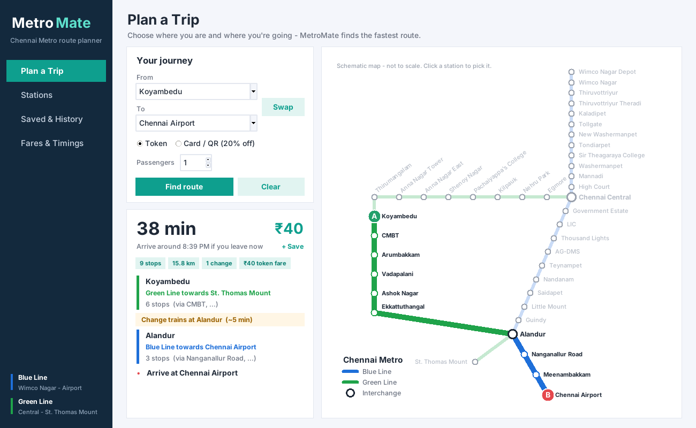
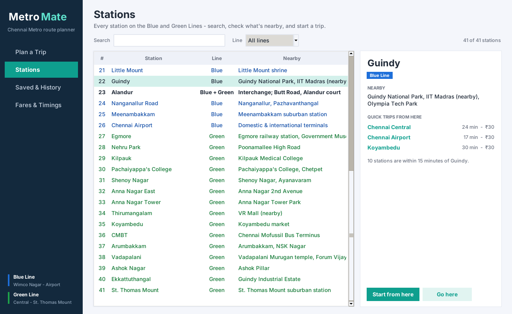
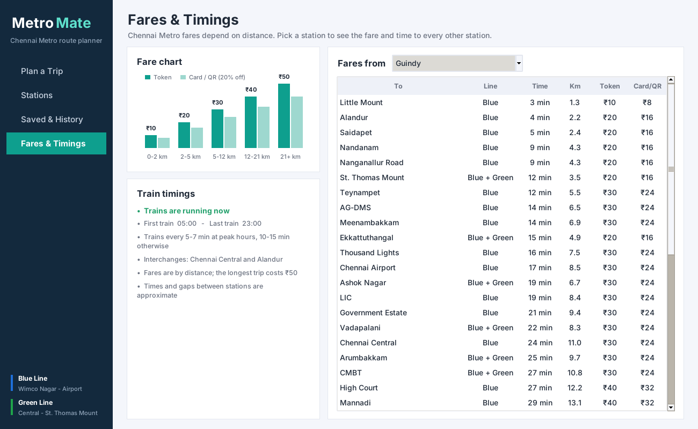

# MetroMate - Chennai Metro Route Planner

A Tkinter desktop app that finds the fastest route between any two Chennai Metro stations,
shows it on an interactive map, and tells you the travel time, stops, changes and fare.

## Features
- Click two stations on the map (or pick from the lists) to get the fastest route
- Dijkstra's shortest-path algorithm, with a 5-minute penalty for changing lines
- Travel time, stops, distance, interchanges and step-by-step directions
- Distance-based fares for tokens and card/QR tickets (20% off), for up to 10 passengers
- Favourite routes and search history saved in SQLite
- Searchable list of all 41 stations with nearby landmarks
- Fare and time table from any station to every other station

| Stations | Fares & Timings |
|---|---|
|  |  |

## Run
Only Python 3 is needed (Tkinter and SQLite come with it). No pip installs.

    python main.py

(If `python` is not recognised on Windows, use `py main.py`.)

## Tests

    python -m unittest test_router -v

## Files
| File | What it does | Owner |
|---|---|---|
| main.py | Main window, sidebar, switching screens | N. Raghav |
| theme.py | Colours, fonts, styles | N. Raghav |
| map_view.py | Interactive metro map on a Canvas | N. Raghav |
| screens.py | Plan a Trip, Stations (Raghav); Saved & History, Fares (Anirveda) | Raghav, Anirveda |
| metro_data.py | Stations, distances, fares, timings, landmarks | Adwiti Sharma |
| router.py | Dijkstra's shortest path, fares, directions | Adwiti Sharma |
| database.py | SQLite favourites, history, settings | Adwiti Sharma |
| test_router.py | 11 unit tests | Anirveda Mandal |

## Team
- **N. Raghav** - UI, interactive map and navigation
- **Adwiti Sharma** - station data, routing and database
- **Anirveda Mandal** - Saved & History and Fares screens, testing

*Distances between stations are approximate, so times and fares are estimates.*
